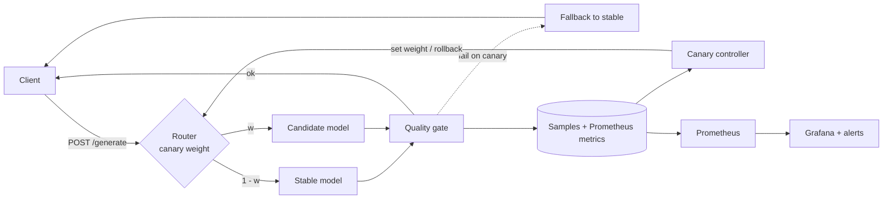
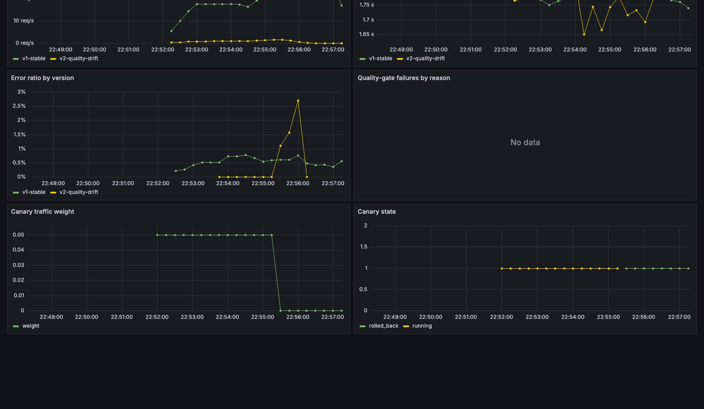

# genmedia-guard

Reliability tooling for generative-media model APIs: **SLO-gated canary rollouts, output-quality gates and drift detection**, with Prometheus metrics, alerts and a Grafana dashboard.

Generative models fail differently from ordinary services. A bad model version can keep returning HTTP 200 and healthy latency while its output quietly turns blank, saturated or blurry. Uptime dashboards never see that. `genmedia-guard` treats output quality as a first-class reliability signal next to latency and errors, and uses it to decide, automatically, whether a new model version keeps its traffic.

> **Scope note.** The models here are simulated (`fake_model.py`), so the whole system runs, tests and demos without a GPU. The reliability logic (routing, gates, rollback, metrics) is model-agnostic; swapping in a real backend means implementing one `generate(seed) -> (image, latency_ms)` method. See [Limitations](#limitations).

## How it works



1. **Progressive traffic.** A candidate model gets 5% of traffic, then 25%, then 50%, then is promoted. Each step is judged only on its own traffic.
2. **Gates at every step.** The candidate must pass all of these over a full observation window:
   - absolute SLOs: p95 latency and error rate;
   - relative gates against the stable version running at the same time (p95 ratio, error-rate delta), so a slow period for both is not blamed on the candidate;
   - output-quality failure rate: blank, saturated or wrong-shape images;
   - output drift: Population Stability Index (PSI) of a sharpness feature against a baseline from the stable model.
3. **Automatic rollback.** Any failed gate sets the canary weight to 0 and records the reasons. A catastrophic error rate triggers an early rollback before the full evidence threshold.
4. **Request-level mitigation.** If a canary request fails or its output is rejected, the user is still served by the stable version (`fallback: true`), so a bad rollout costs latency, not correctness.
5. **Observability.** Prometheus metrics, alert rules and a provisioned Grafana dashboard.

## Results from the simulator

Deterministic runs on virtual time (50 requests/s, 60 s per step, `python -m genmedia_guard.simulate --all`):

| Candidate defect | Outcome | Rolled back at | Reason reported |
|---|---|---|---|
| none (`healthy`) | promoted | n/a (180 s to full traffic) | all gates passed at every step |
| 10% slower (`slightly-slower`) | promoted | n/a | within SLO and under the 1.25x relative limit |
| p95 latency regression | rolled back | 55 s, at 5% traffic | canary p95 is 1.53x stable (limit 1.25x) |
| 8% error rate | rolled back | 55 s, at 5% traffic | error rate 5.7% exceeds SLO 2.0% |
| blurry outputs (gradual drift) | rolled back | 55 s, at 5% traffic | output drift PSI 2.78 exceeds limit 0.25 |
| 6% blank images (silent collapse) | rolled back | 55 s, at 5% traffic | 4.7% of canary outputs fail quality checks |

Every defect is caught while the candidate is still on the smallest traffic slice. The drift and silent-collapse defects are invisible to an uptime check; the silent-collapse candidate returns HTTP 200 throughout.

## Quickstart

```bash
pip install -e ".[dev]"
pytest -q                                              # 37 tests
python -m genmedia_guard.simulate --all                # the table above
python -m genmedia_guard.simulate --scenario quality-drift
```

Run the HTTP service and try a rollout by hand:

```bash
uvicorn genmedia_guard.app:create_app --factory --port 8000

curl -s -X POST localhost:8000/canary/start -d '{"scenario": "silent-collapse"}'
python -m genmedia_guard.loadgen --url http://localhost:8000 --rps 20 --duration 120
curl -s localhost:8000/canary        # state, weight and rollback reasons
curl -s localhost:8000/metrics       # Prometheus exposition
```

Full stack with Prometheus and Grafana:

```bash
docker compose up --build
# Grafana: http://localhost:3000  (dashboard "genmedia-guard: canary & SLOs")
# Prometheus: http://localhost:9090
curl -s -X POST localhost:8000/canary/start -d '{"scenario": "quality-drift"}'
python -m genmedia_guard.loadgen --rps 20 --duration 300
```

The dashboard after a `quality-drift` rollout (20 to 40 requests/s of load; the candidate starts at 5% of traffic, then the controller sets its weight to 0 because the output-drift gate fails, PSI 4.00 against a limit of 0.25):



The "Quality-gate failures by reason" panel stays empty in this run: blurry outputs pass the per-image sanity checks and are caught by the drift gate instead. Run `silent-collapse` to see that panel fill.

Available scenarios: `healthy`, `slightly-slower`, `latency-regression`, `error-spike`, `quality-drift`, `silent-collapse`.

## Endpoints

| Method and path | Purpose |
|---|---|
| `POST /generate` | `{"prompt": str, "seed": int}`; returns version, latency, quality report, fallback flag |
| `POST /canary/start` | `{"scenario": "..."}`; starts a rollout of a simulated candidate |
| `GET /canary` | current state, traffic weight, window statistics, rollback reasons |
| `GET /metrics` | Prometheus metrics |
| `GET /healthz` | liveness and readiness |

Metrics: `genmedia_requests_total{version,status}`, `genmedia_request_duration_seconds` (histogram), `genmedia_quality_failures_total{version,reason}`, `genmedia_fallback_total`, `genmedia_canary_weight`, `genmedia_canary_state{state}`, `genmedia_canary_rollbacks_total`, `genmedia_canary_promotions_total`.

## Project layout

```
genmedia_guard/
  canary.py      traffic steps, gates, rollback decisions (pure logic, injectable clock)
  slo.py         SLO definitions, sliding window, p95 and burn rate
  quality.py     output validator, sharpness feature, PSI drift score
  service.py     request path: routing, model call, quality gate, fallback, metrics
  app.py         plain ASGI front end (no web framework)
  metrics.py     small Prometheus text-format registry
  fake_model.py  simulated model versions with injectable defects
  simulate.py    deterministic rollout simulator on virtual time
  loadgen.py     stdlib load generator for the demo
deploy/          Prometheus config and alerts, Grafana dashboard, Kubernetes manifests
tests/           unit tests, simulator scenarios, ASGI tests
```

## Design decisions

- **Decisions are pure functions of recorded samples and a clock.** `CanaryController` never calls a model or reads the wall clock directly, so every gate is unit-tested deterministically and the simulator can run 3 minutes of traffic in seconds.
- **Relative gates next to absolute SLOs.** A candidate that is 50% slower can still sit under the absolute SLO; comparing against the stable version at the same moment catches it, and ignores shared slowdowns.
- **PSI with few bins.** PSI is biased upward on small samples (roughly `(bins - 1) * (1/n_baseline + 1/n_current)`). The gate uses 5 baseline-quantile bins and requires at least 100 canary outputs, which keeps the false-positive rate low (see `tests/test_quality.py`).
- **No web framework and no `prometheus_client`.** The service is a small ASGI app and the metrics module is under 170 lines, so the core has two dependencies (`numpy`, `uvicorn`) and the exposition format is covered by tests.
- **Fail the canary, not the user.** Fallback to the stable version keeps user-facing correctness during a bad rollout.

## Limitations

- **Simulated models.** Quality checks are generic image sanity checks plus a sharpness feature. A real deployment would add model-specific evaluation (for example safety classifiers, embedding-based drift, prompt-class-specific checks).
- **In-process controller state.** The rollout state lives in memory, so the Kubernetes manifest runs one replica with a `Recreate` strategy. A multi-replica version needs shared state (for example a Redis-backed window) or a Kubernetes controller.
- **Docker Compose and Kubernetes files are not exercised in CI.** The Compose stack was built and run once by hand on Docker Desktop (Windows, WSL2) to produce the dashboard screenshot above. The Kubernetes manifests were only validated as well-formed YAML; I have not applied them in a cluster. Treat them as a starting point.
- **Single-signal drift.** Drift uses one scalar feature (sharpness). It catches blur and collapse but not, say, subtle colour or composition shifts.

## Roadmap

- Backend adapter for a real `diffusers` pipeline (GPU) behind the same interface.
- Shadow testing: mirror traffic to the candidate without serving its output.
- Multi-feature drift (colour histogram, embedding distance) and per-prompt-class gates.
- Kubernetes-native rollout analysis (for example Argo Rollouts `AnalysisTemplate`) using the same Prometheus queries.

## License

MIT
